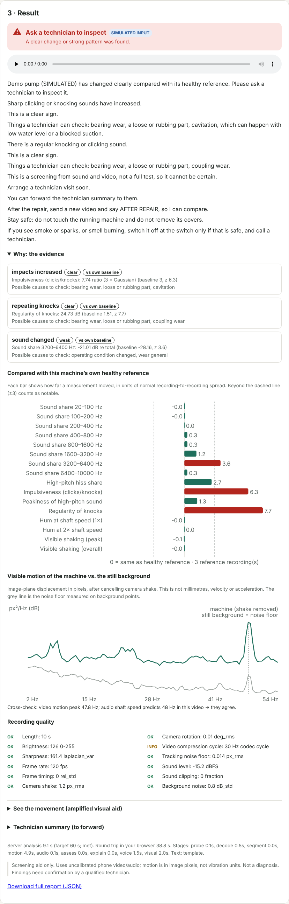
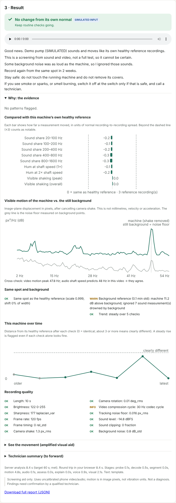

# Stetho

**Is this pump different from its own normal?**

Stetho is a phone-video *screening* aid for small electric water pumps and motors, designed for WhatsApp. An owner rests a phone near a running pump and sends a 10–15 s video. Stetho checks recording quality, cancels hand shake using the still background, extracts sound and visible-motion evidence, and compares it with **that machine's own healthy recordings**. The reply is a short voice note in English or Hindi with one next step: *carry on*, *re-record soon*, or *ask a technician*. After a repair, it checks whether the machine has returned towards its healthy reference.

> **Status: honest summary.** The full pipeline (intake, quality gate, motion and audio analysis, baseline comparison, assessment, explanation, voice note, visual aid, WhatsApp webhook, web UI) is implemented and covered by 72 passing tests. It has only been exercised on **simulated** recordings and **mocked** WhatsApp/LLM APIs. It has **not** been validated on real pumps or against accelerometers. The claims in the original idea about test-rig accelerometer validation are unverified, and no such data exists in this repository. See [`docs/VALIDATION_PROTOCOL.md`](docs/VALIDATION_PROTOCOL.md) for how to produce that evidence.



## Why this approach

A phone is a weak absolute vibration instrument: uncalibrated microphone, low frame rate (aliasing), rolling shutter, heavy compression, unknown distance and speed. The **same phone at the same marked spot on the same machine** is much more consistent *relative to itself*. So Stetho's primary output is a **change-from-own-baseline** decision, not a named fault. Supporting this are:

1. **Repair verification.** "Is it back to its own normal?" (never "it is fixed").
2. **A quality gate with abstention.** Bad recordings get specific re-recording advice instead of a guess.

Three features protect the baseline comparison from its main real-world failure modes:

| Feature | Failure it prevents | How |
|---------|---------------------|-----|
| **Same-spot check** | Comparing recordings taken from different positions | A view fingerprint (ORB keypoints, no image) is matched to the baseline view. "Moved" gets a hint (closer / back / sideways), and movement features are not compared. "Different view" asks whether it's the same machine. |
| **Background-noise reference** (`AMBIENT`) | A new generator, pump or insects nearby looking like machine change | A 10 s recording with the machine **off**. Bands where the machine isn't at least 6 dB louder than the background are excluded. A stale reference (background louder than machine + background) is detected and not used. |
| **Slow-drift detection** | Gradual wear that never crosses the per-check threshold | A Theil–Sen trend of distance-from-healthy across checks since the last repair, with explicit agreement and size rules. A rising trend escalates "no change" to "watch". Each machine gets a health timeline. |



The full reasoning, alternatives considered, scope (monoblock pumps, small farms and workshops), and verified model and provider status are in [`docs/DESIGN.md`](docs/DESIGN.md). Physics limits and what is and isn't established are in [`docs/SCIENCE.md`](docs/SCIENCE.md).

## Quick start (offline, no credentials)

Requirements: Python ≥ 3.10, `ffmpeg`/`ffprobe`, and optionally `espeak-ng` for voice notes.

```bash
sudo apt-get install -y ffmpeg espeak-ng
```

```bash
pip install -r requirements.txt
```

Run the full simulated maintenance story in the terminal: 3 baselines → routine check → bad recording → moved phone → slow wear with a rising trend → clear bearing fault → after repair → new background noise, with and without a background reference.

```bash
python -m stetho demo
```

Start the web demo at http://127.0.0.1:8000 (upload your own video, or click a simulated scenario):

```bash
python -m stetho serve
```

Analyse your own recording (baselines persist in `var/stetho.db`):

```bash
python -m stetho analyze pump.mp4 --machine "well pump" --mode baseline --rpm 2880
```

```bash
python -m stetho analyze pump_today.mp4 --machine "well pump" --lang hi --json report.json
```

Run the tests:

```bash
python -m pytest -q
```

## WhatsApp setup (optional)

1. Create a Meta app with the WhatsApp product and a test number (WhatsApp Cloud API).
2. Copy `.env.example` to `.env`. Set `WHATSAPP_VERIFY_TOKEN`, `WHATSAPP_APP_SECRET`, `WHATSAPP_ACCESS_TOKEN` and `WHATSAPP_PHONE_NUMBER_ID`, and check `WHATSAPP_GRAPH_VERSION` against Meta's current docs. Load the file into the environment (e.g. `set -a; . ./.env; set +a`).
3. Expose the server over HTTPS (e.g. a tunnel) and register `https://<host>/webhook/whatsapp` as the webhook. Subscribe to `messages`.
4. Message the number. Stetho asks for consent first.

Commands: `YES`, `HELP`, `HINDI`/`ENGLISH`, `MACHINE <name>`, `BASELINE`, `BEFORE REPAIR`, `AFTER REPAIR`, `AMBIENT` (background-noise reference, machine off), `HISTORY` (recent results and trend), `RPM <n>`, `CONFIRM` (nameplate), `TECH` (technician summary), `DELETE`. Send a photo of the nameplate to have it read (needs `MODEL_API_KEY`). Values are range-checked and need your `CONFIRM`.

The WhatsApp code follows the Cloud API's documented webhook, media and messages flow, and is tested against a mocked Graph API. **It has not been run against a live WhatsApp Business account.**

## Optional providers

| Provider | Env | Used for | Without it |
|----------|-----|----------|-----------|
| Meta Model API (Muse Spark) | `MODEL_API_KEY`, `MODEL_API_BASE_URL`, `MODEL_API_MODEL` | Rewriting the template into natural language, and nameplate reading. Every rewrite must pass a guard (no new numbers, no certainty or unsafe phrases), or the template is used. Never used to decide anything. | Deterministic templates (en, hi) |
| SAM 3 / 3.1 (`facebookresearch/sam3`) | `STETHO_SEGMENTER=auto\|sam3`; needs a CUDA GPU and gated weights (SAM License) | Labelling machine vs. background pixels | Centre prior (matches the recording guide) or a user box |
| espeak-ng | `STETHO_TTS=espeak` | Voice note (OGG/Opus) | Text-only reply |

## Architecture

```
stetho/
  media.py       probe/decode, measured frame timing, codec picture-type cycle
  quality.py     recording-quality gate with re-record advice
  segment.py     SAM 3 adapter | user box | centre prior
  motion.py      LK tracking, background-referenced camera-motion compensation,
                 held-out static-reference noise floor, aliasing + codec alias family
  audio.py       spectral shape, mains hum, shaft-speed comb, impulsiveness, envelope periodicity
  baseline.py    machine-specific baseline comparison, repair verdict, background-noise masking, drift trend
  spot.py        same-spot check (ORB view fingerprint, no image stored)
  assessment.py  interpretable rules, abstention, hypotheses, next steps (no LLM)
  explain.py     templates (en, hi), technician summary, LLM output guard
  llm.py         optional Muse Spark client (guarded rewrite, nameplate)
  tts.py         espeak-ng → OGG/Opus voice note
  magnify.py     stabilised Eulerian motion magnification (labelled visual aid)
  pipeline.py    orchestration + per-stage timing
  store.py       SQLite; pseudonymised users; features only
  whatsapp.py    Cloud API webhook client + conversation flow
  server.py      FastAPI: web UI, REST API, webhook
  synth.py       SIMULATED recordings with known ground truth (tests and demo only)
  web/           accessible single-page UI
```

Evidence extraction and assessment never depend on the language model. Explanations are rendered from the structured assessment.

## What works today (tested)

Results from `python -m pytest -q` in this repository: **72 passed**. On simulated inputs:
- Motion: under simulated hand shake, the 48 Hz shaft motion is recovered at 120 fps, and the uncompensated measurement is dominated by shake (ablation test). At 30 fps the measured peak sits at the predicted alias (12 Hz). A machine filling the frame is reported as "no static reference", not guessed.
- Audio: mains (50/60 Hz) and shaft speed (2- and 4-pole cases) identified. Shape features are unchanged by a 10 dB gain change. Simulated bearing impacts give a periodic envelope at 3.58× shaft speed. Simulated cavitation is impulsive but not periodic.
- Decisions: healthy → `no_change`; simulated bearing defect → `technician` (clear, vs. own baseline); after simulated repair → `back_to_baseline`; dark or short recordings → `rerecord` and are not stored as baselines; no baseline and no strong pattern → `no_reference` (abstains).
- Same spot: shake and dimmer light still count as the same spot. A 50 px shift, 1.3× zoom-in and 0.85× zoom-out are each detected with the right hint. A different scene is reported as a different view.
- Background noise: a new 3–6 kHz noise source caused a false "technician" decision without a reference (the reply now suggests saving one). With an `AMBIENT` reference, the same check gave "no change" with 7 drowned measurements excluded. Stale references are detected.
- Drift: in the simulated slow-wear story, the trend was flagged as rising at the 6th check, while the per-check result was still only "possible change". The clear "technician" result came at the next, stronger fault.
- Safety and grounding: explanations contain no percentages and always include the safety lines. The guard rejects LLM output with new numbers (Latin or Devanagari digits), certainty words or unsafe advice. Provider failures fall back to templates.
- Intake: signature verification, consent before analysis, duplicate message ids ignored, download failure, oversized media, timeouts and analysis crashes all produce a user reply. Media is deleted after analysis. Phone numbers are not stored.
- Latency: on this development container's CPU, server-side analysis of a 10 s simulated clip took about **3.5–5.5 s at 60 fps** and **6–10 s at 120 fps**, including voice note and magnified clip. This excludes WhatsApp upload and download time, which hasn't been measured.

## Known limitations (read before using)

- **Not validated on real machines.** All thresholds and repeatability floors are engineering guesses or simulator-tuned values.
- **Pixels are not vibration units.** No mm/s, no g, no ISO 20816 zones.
- **Compression matters.** On simulated video, inter-frame (B-frame) H.264 suppressed sub-pixel motion by about 80× in power and shifted its apparent frequency. Stetho measures the codec cycle and weakens its cross-check accordingly. Send videos as a WhatsApp *document* when possible. Details are in `docs/SCIENCE.md`.
- **Low frame rates alias** the shaft frequency of 2-pole motors. Audio carries the speed estimate.
- **Operating point** (head, flow, water level, voltage) changes healthy signatures. Record baselines at the usual condition.
- **Background noise** from other machines, speech or wind can mask or mimic patterns.
- **Background references are approximate.** Phone gain control differs between a quiet and a loud recording. Errors tend to exclude more features, not fewer, and excluded bands can also hide real faults in those bands.
- **A false alarm stays in the timeline.** A check later explained by background noise still counts towards the trend.
- The **centre-prior** region assumes the machine is centred with background visible.
- **espeak-ng** voices are robotic.
- **SAM 3, Muse Spark and live WhatsApp** were not exercised in this environment (no GPU or weights, no API keys, Meta developer docs host blocked by network policy).

## Documents

- [`docs/DESIGN.md`](docs/DESIGN.md): five directions compared, chosen differentiator, scope, architecture, verified provider status, competitive notes
- [`docs/SCIENCE.md`](docs/SCIENCE.md): signal types, implemented vs. hypotheses vs. planned, compression finding, physical limits
- [`docs/VALIDATION_PROTOCOL.md`](docs/VALIDATION_PROTOCOL.md): accelerometer-referenced protocol, ablations, metrics, acceptance criteria, screening vs. diagnostic
- [`docs/DEMO_SCRIPT.md`](docs/DEMO_SCRIPT.md): three-minute demo
- [`docs/PITCH.md`](docs/PITCH.md): 150-word pitch
- [`docs/PRIVACY.md`](docs/PRIVACY.md): retention and privacy controls

## Safety

Stetho never asks anyone to touch running machinery, remove guards or covers, or stand in an unsafe position. If there is smoke, sparks or a burning smell, switch off at the switch only if it is safe to do so, and call a qualified technician. Stetho's output is a screening aid that needs a technician's confirmation. It is never a statement that a machine is safe to run.
